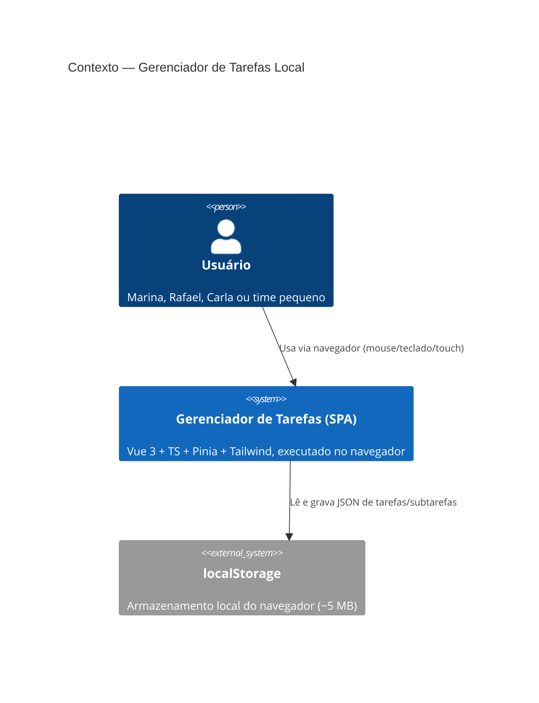
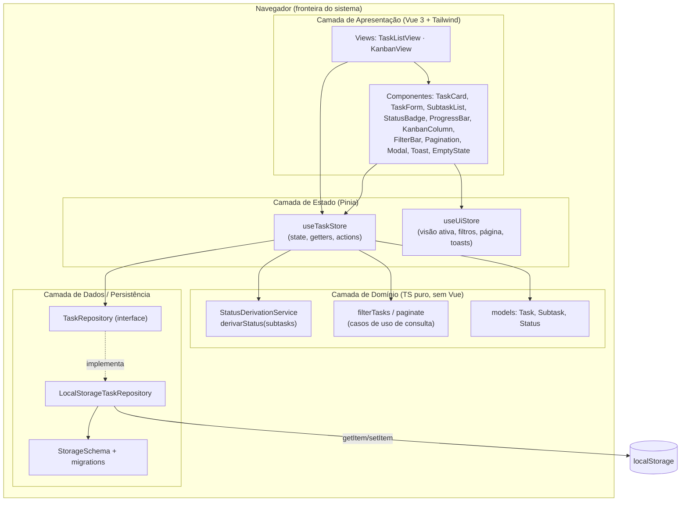
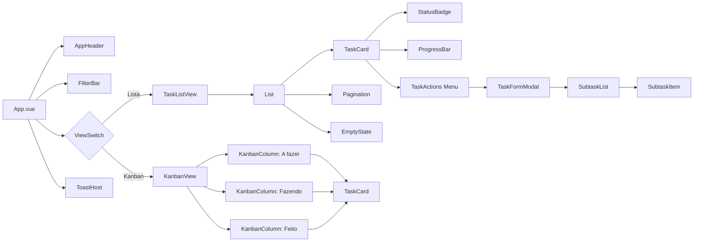
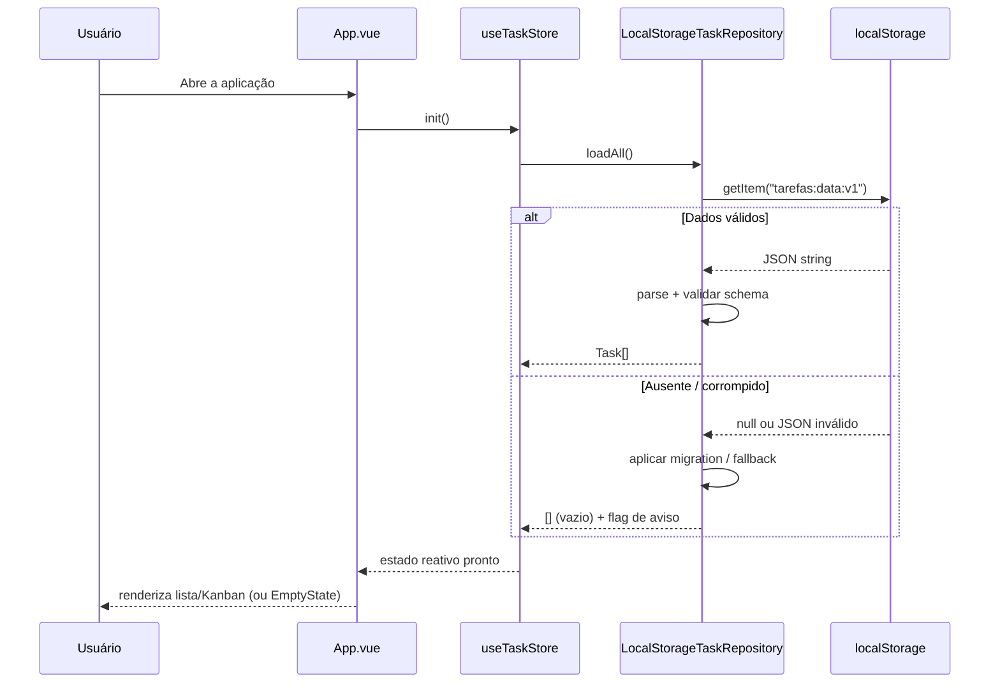
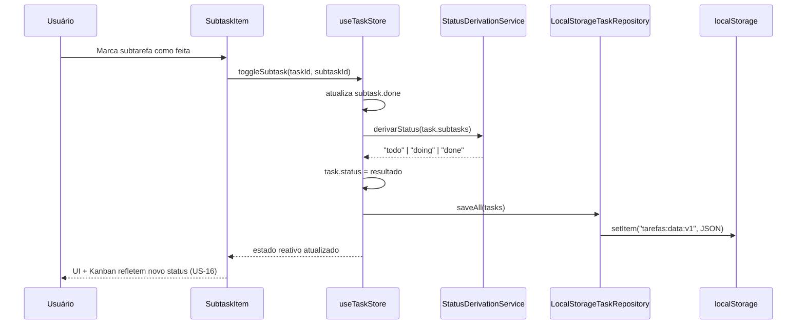
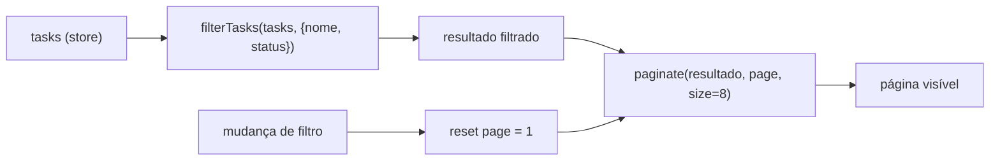

# Diagramas de Arquitetura — Sistema de Gerenciamento de Tarefas

**Autor:** Arquiteto de Software
**Versão:** 1.0
**Data:** 2026-10-15
**Status:** Proposto para revisão
**Fontes:** `outputs/product-owner/requirements.md`, `outputs/product-owner/user-stories.md`, `outputs/product-owner/backlog.md`, `outputs/product-owner/acceptance-criteria.md`, `outputs/ux/design-system.md`

---

## 1. Visão Geral do Sistema

Aplicação **SPA (Single Page Application)** 100% client-side. Não há backend, API remota,
banco de dados nem autenticação (RES-4, RES-5, §8 do PO). Todo o estado vive na memória do
navegador e é persistido em `localStorage`.

**Características arquiteturais (atributos de qualidade):**

| Atributo | Meta | Origem |
|----------|------|--------|
| Persistência | Dados preservados entre sessões sem servidor | OBJ-4, US-18 |
| Responsividade | Desktop, tablet e mobile sem scroll horizontal | OBJ-5, US-19 |
| Acessibilidade | WCAG 2.1 AA | OBJ-5, design-system §5 |
| Manutenibilidade | Estado centralizado, domínio isolado da UI | RES-1..RES-3 |
| Performance | Lista paginada (8/pág) e Kanban fluido com scroll | RES-6, R-4 |
| Segurança | Sem rede, sem PII em trânsito; dados apenas locais | RES-4, RES-5 |

### 1.1 Estilo arquitetural adotado

**Monólito modular client-side em camadas (Layered SPA)** com separação estrita entre
**domínio**, **dados/persistência** e **apresentação**, mediada por uma store **Pinia**.

Justificativa: o escopo é pequeno, single-user e sem integrações. Microserviços/DDD tático
seriam sobre-engenharia (ver `adrs.md` — ADR-001). Ainda assim, isolamos a **regra de negócio
central** (status derivado, US-10) em um módulo de domínio puro, testável e independente do Vue.

---

## 2. Diagrama de Contexto (C4 — Nível 1)



**Fronteira do sistema:** tudo roda no dispositivo do usuário. Não há atores externos,
serviços de terceiros, rede ou backend.

---

## 3. Diagrama de Containers / Camadas (C4 — Nível 2)



**Regras de dependência (invioláveis):**
- Apresentação → Estado → Domínio → Dados.
- **Domínio não conhece Vue nem Pinia** (TS puro, testável).
- **Domínio não conhece `localStorage`** — depende apenas da interface `TaskRepository`.
- Nenhuma camada superior é acessada de baixo para cima.

---

## 4. Estrutura de Componentes (decomposição da UI)



**Contratos de componente (resumo; detalhes no design system do UX):**

| Componente | Responsabilidade | Props/entradas | Eventos/saídas |
|-----------|------------------|----------------|----------------|
| `TaskListView` | Lista paginada e filtrada | — | — |
| `KanbanView` | 3 colunas por status derivado | — | — |
| `TaskCard` | Exibe nome, descrição, badge, progresso | `task` | `open`, `edit`, `delete` |
| `TaskFormModal` | Criar/editar tarefa | `mode`, `task?` | `submit`, `cancel` |
| `SubtaskList` | Gerencia subtarefas | `taskId` | `toggle`, `add`, `edit`, `remove` |
| `StatusBadge` | Comunica status (cor+ícone+texto) | `status` | — |
| `ProgressBar` | Indicador K/N acessível | `done`, `total` | — |
| `FilterBar` | Busca por nome + filtro de status | `filters` | `update:filters` |
| `Pagination` | Navegação 8/pág | `page`, `total` | `change` |
| `EmptyState` | Estado vazio com CTA | `title`, `cta?` | `action` |
| `ToastHost` | Feedback não bloqueante | — | — |

---

## 5. Fluxo de Dados

### 5.1 Leitura (bootstrap da aplicação)



### 5.2 Escrita — marcar subtarefa como feita e derivar status (US-08 + US-10)



**Observação:** o status é **derivado na leitura e recalculado em memória** a cada mutação —
nunca persistido como fonte de verdade editável. Persistir o valor calculado é **cache**, não
verdade (ver `design-patterns.md` §3 e `adrs.md` ADR-004).

### 5.3 Filtro + paginação (US-11..US-14)



Getters Pinia encadeados garantem que a paginação **sempre** opera sobre o subconjunto
filtrado (critério de aceitação US-14) e que qualquer alteração de filtro reinicia a página.

---

## 6. Modelo de Dados (tipos TypeScript)

```ts
// domain/models.ts — TS puro, sem dependências de framework
export type Status = 'todo' | 'doing' | 'done';

export interface Subtask {
  id: string;        // UUID/crypto.randomUUID()
  title: string;     // obrigatório, não-vazio após trim
  done: boolean;
}

export interface Task {
  id: string;
  title: string;       // obrigatório
  description?: string; // opcional
  subtasks: Subtask[];
  status: Status;      // derivado (cache); nunca editável pela UI
  createdAt: string;   // ISO 8601
  updatedAt: string;   // ISO 8601
}

export interface TaskFilters {
  name: string;         // busca textual case-insensitive
  status: Status | 'all';
}

export interface AppStateV1 {
  schemaVersion: 1;
  tasks: Task[];
}
```

**Chave de armazenamento:** `tarefas:data:v1` (ver `adrs.md` ADR-006 — estratégia de
versionamento/migração, ponto a validar em §10 do PO).

---

## 7. Integrações

| Integração | Tipo | Direção | Observações |
|-----------|------|---------|-------------|
| `localStorage` (Web Storage API) | Interna ao navegador | Leitura/Escrita | Única dependência de persistência (RES-4) |
| `crypto.randomUUID()` | Web API | Geração de ID | Fallback para `Date.now()+random` em navegadores antigos |
| Sistema de arquivos | — | — | **Não há** (sem upload/export no MVP, §8) |
| Serviços externos / backend | — | — | **Não há** (RES-5) |

Nenhuma integração de rede, portanto não há gateway/API layer, autenticação, CORS ou
tratamento de latência a projetar no MVP.

---

## 8. Navegação e Roteamento

MVP é **single-view com alternância Lista/Kanban** (US-21). Duas abordagens (decisão em
`adrs.md` ADR-007):

- **Escolhida:** estado de visão em Pinia (`useUiStore.activeView`) + troca de componente
  (sem roteador). Mais simples, preserva filtros naturalmente.
- Reservado: `vue-router` para deep-linking futuro, fora do MVP.

---

## 9. Tratamento de Erros e Resiliência

| Cenário | Estratégia | Referência |
|---------|-----------|------------|
| `localStorage` indisponível (modo privado/cheio) | Capturar exceção, iniciar vazio em memória, exibir aviso | US-18 (critério de aceitação) |
| JSON corrompido | Validar schema; se inválido, isolar dados e iniciar vazio com aviso | US-18, R-2 |
| Limite ~5 MB excedido | Detectar `QuotaExceededError`; avisar via toast; documentar limite | R-1 |
| Nome vazio/whitespace | Validação na UI + guarda no domínio; bloqueia persistência | US-01, US-03 |

---

## 10. Rastreabilidade Requisitos → Arquitetura

| Requisito | Componente(s) arquitetural(is) |
|-----------|-------------------------------|
| US-01..US-04 (CRUD Task) | `TaskFormModal`, `TaskCard`, `useTaskStore`, `TaskRepository` |
| US-05..US-09 (CRUD Subtask + progresso) | `SubtaskList`, `ProgressBar`, `useTaskStore` |
| US-10 (status derivado) | `StatusDerivationService` (domínio) |
| US-11..US-14 (filtros/paginação) | `FilterBar`, `Pagination`, getters da store |
| US-15..US-17 (Kanban) | `KanbanView`, `KanbanColumn` |
| US-18 (persistência) | `LocalStorageTaskRepository`, `StorageSchema` |
| US-19..US-21 (UX/responsivo/visões) | Camada de apresentação + design system |

---

## 11. Handoff

| Entregável desta arquitetura | Consumidor |
|------------------------------|-----------|
| Estrutura de camadas e de pastas | **Frontend Dev** |
| Interface `TaskRepository` e schema v1 | **Frontend Dev** / **Tester** |
| Contratos de componente | **UI Designer** / **Frontend Dev** |
| Estratégia de migração do `localStorage` | **Frontend Dev** (validar com PO) |
| Pontos a validar (§10 PO) | **PO** + **Arquiteto** |

**Próximos artefatos relacionados:** `tech-stack.md`, `design-patterns.md`,
`development-guidelines.md`, `adrs.md`.
